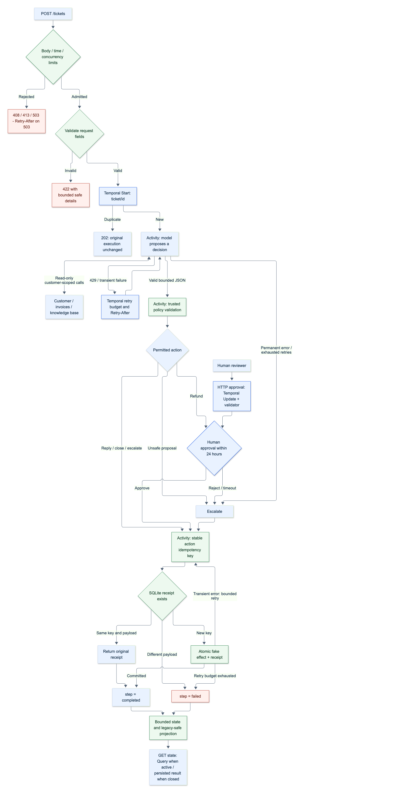
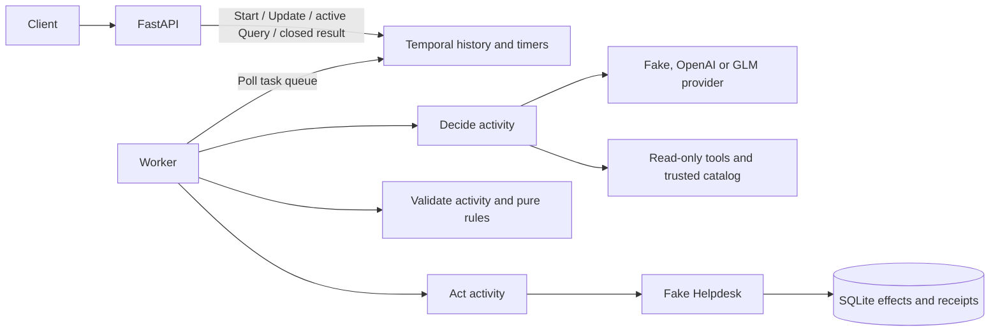

# Northdesk

A small support backend using FastAPI, Temporal and an agent with read-only tools. Refunds are checked in code and wait for human approval. Workflow history survives worker restarts; fake Helpdesk effects survive retries and process restarts.

[Polski szybki start](README.pl.md) · [Flowchart and design review](docs/architecture.md) · [Fix verification](docs/fixes.md) · [Extensive review](docs/extensive-review.md)

## Run

Requires Docker with Compose. No API key or local Python installation is needed for the service or test suite.

```bash
LLM_MODE=fake HELPDESK_FAILURE_RATE=0 docker compose up --build -d --wait
```

- API and Swagger: <http://localhost:8000/docs>
- Temporal UI: <http://localhost:8233>
- Readiness: <http://localhost:8000/health/ready>
- Recent workflow/activity pollers: <http://localhost:8000/health/worker>

Run all seven examples in a fresh demonstration, explicitly approving simulated refunds:

```bash
python3 scripts/demo.py --suffix=-demo-$(date +%s) --approve-refunds
```

The default is `LLM_MODE=fake`. `.env` is optional; `.env.example` lists the settings. Ports bind to localhost. API and worker use the same application image and run as an unprivileged user. Temporal's local dev server also runs without root. Named volumes preserve Temporal history and fake Helpdesk actions.

```bash
docker compose logs -f api worker
docker compose down             # stop; preserve data
```

Deleting the named volumes deletes the demonstration history and action receipts. Use new ticket IDs to repeat an experiment without deleting data.

## Try the API

Create a password ticket:

```bash
curl -sS http://localhost:8000/tickets -H 'Content-Type: application/json' -d '{
  "ticket_id":"T-1", "customer_id":"C-200", "subject":"Can\u0027t log in",
  "body":"I forgot my password and can\u0027t get into my account."
}'
```

This returns HTTP 202 and `{"ticket_id":"T-1","workflow_id":"ticket/T-1","duplicate":false}` as soon as Temporal accepts the start. A worker need not be available at that point. Repeating the request returns the same IDs with `duplicate:true`, including after completion. The first submitted content wins; a duplicate never changes it.

```bash
curl -sS http://localhost:8000/tickets/T-1
```

The response includes `step`, `proposal`, `decision`, `approval`, `approval_deadline`, `result`, `error`, and `payload_warning`. The proposal is bounded model output; the decision is the validated action, possibly replaced by escalation. A completed reply includes KB-1 and its password instructions. `payload_warning` is normally null; it explains omitted unsafe/oversized legacy text while preserving the recorded action and receipt identity.

Create a refund ticket:

```bash
curl -sS http://localhost:8000/tickets -H 'Content-Type: application/json' -d '{
  "ticket_id":"T-2", "customer_id":"C-100", "subject":"Charged twice",
  "body":"We were charged twice for September. Please refund the extra payment."
}'
curl -sS http://localhost:8000/tickets/T-2
```

Wait until `step` is `awaiting_approval`, then approve or reject it:

```bash
curl -sS http://localhost:8000/tickets/T-2/approval -H 'Content-Type: application/json' -d '{
  "approved":true, "reviewer":"demo-operator"
}'
curl -sS http://localhost:8000/tickets/T-2
```

Set `approved` to `false` to reject. Rejection or no response within 24 hours produces an escalation. An approval request returns when the workflow records it, before the Helpdesk action necessarily finishes. The reviewer is a demonstration label; production must derive it from an authenticated operator.

| HTTP status | Meaning |
| --- | --- |
| 202 | Ticket start accepted, or existing workflow returned |
| 200 | State read, or approval recorded |
| 404 | Ticket does not exist |
| 408 | Request body did not arrive within its time budget |
| 409 | Approval is premature, conflicting, expired, or the workflow is closed |
| 413 | Raw request body exceeds its byte budget, including chunked bodies |
| 422 | Invalid request shape or field value |
| 503 | Backend unavailable, or bounded admission/query capacity is busy |
| 504 | Temporal operation exceeded its time budget |

Ticket IDs in all three operations use 1–80 ASCII letters, digits, `_` or `-`; invalid routed IDs return 422 before Temporal dispatch.

A capacity rejection includes `Retry-After: 1` and happens before that operation is dispatched. Respect it and reuse the ticket ID. The demo/load scripts implement bounded retries for these explicit admission rejections. A transport timeout on approval remains ambiguous: read status before deciding whether to retry.

After an HTTP timeout, read state before retrying an approval: the server may have recorded it. The first recorded approval is binding. Identical repeats are harmless while the execution remains open; a closed execution returns 409.

With Python 3.9+ on the host, this optional standard-library script runs all examples:

```bash
python3 scripts/demo.py                              # leaves the refund waiting
docker compose restart worker                       # pending state survives
python3 scripts/demo.py --approve-refunds             # explicitly act as the human
python3 scripts/demo.py --suffix=-second --approve-refunds
```

The per-ticket demo wait budget defaults to 480 seconds to cover bounded model and delivery retries; use `--timeout-seconds 60` for a shorter smoke run. The script still returns immediately when a ticket settles or waits for an approval you have not requested it to supply.

| Example | Fake mode policy |
| --- | --- |
| T-1 | Account reply using KB-1 |
| T-2 | Billing refund of EUR 49.00 on INV-1002, after approval |
| T-3 | Urgent technical escalation for the enterprise outage |
| T-4 | Account reply using KB-4 |
| T-5 | Close an unrelated request |
| T-6 | Block the proposed EUR 5000 refund and escalate |
| T-7 | Escalate the unknown customer without retrying that lookup |

## Tests and code quality

One command builds the test image and runs Ruff lint, Ruff format checking, mypy, and every test:

```bash
make test
```

The three wall-clock activity timeout tests are opt-in (about seven minutes sequentially). They were also run separately after the fixes:

```bash
docker compose --profile test run --rm --no-deps -e RUN_SLOW_TIMEOUT_TESTS=1 tests pytest tests/slow/test_activity_timeouts.py -q
```

All former expected-failure reproductions are ordinary passing regression tests. Historical reports under `docs/review-artifacts` describe the pre-fix version; current evidence is under `docs/fix-artifacts`.

Equivalent without Make:

```bash
docker compose --profile test run --build --rm --no-deps tests
```

The **build** needs network to fetch dependencies and a pinned, SHA-256-verified Temporal test-server binary. The **test container** has `network_mode: none`: all tests run without external network, API keys, or a running Compose stack. Local loopback is used for Temporal's embedded test server. Nothing is downloaded at test runtime. Linux ARM64 and AMD64 binaries are supported natively; the Mac ARM64 helper is also available. The application and test server versions are pinned rather than relying on SDK auto-download behavior.

For an already built image:

```bash
docker compose --profile test run --rm --no-deps tests
```

For local development with uv and Python 3.12:

```bash
uv sync --locked
uv run scripts/download_test_server.py
make check
uv run --locked pytest -q
uv run ruff check . --fix
uv run ruff format .
```

GitHub Actions runs the same container command on every push and pull request. Coverage includes:

- Pure policy tests: allowed values, required payloads, KB references, invoice ownership, paid status, exact amounts, invalid precision and non-finite amounts.
- Agent tests: actual fake tool use, changed catalog results, customer scoping, unknown tools, round/call limits and malformed output. The real OpenAI SDK is exercised through an in-memory HTTP transport, including tool-result continuation and error classification.
- Temporal `WorkflowEnvironment` tests with replaced activities: reply, approved/rejected refund, a full 24-hour timeout using time skipping, transient retry, permanent errors, retry exhaustion, invalid refund, and worker replacement/replay. Cache is disabled in the replacement-worker test to force reconstruction from history rather than sticky-cache routing in the limited test server.
- API tests against Temporal: start without a worker, concurrent duplicate submissions, duplicate after completion, state reads, approval/rejection, missing and closed workflows, invalid input and unavailable backend.
- Helpdesk tests: concurrent duplicates, new service instances, conflicting payloads and loss of confirmation after commit.

## Architecture

The [architecture review](docs/architecture.md) explains ownership, sources, and history compatibility.
The [fix report](docs/fixes.md) maps all eight findings to the repair and its verification.
Earlier [corner-case](docs/review-matrix.md) and [load](docs/limits-review.md) reports remain historical evidence.

[](docs/architecture.svg)



`api.py` maps HTTP to Temporal operations. `workflows/ticket.py` owns the current step, proposal, decision, approval, deadline and result. `activities.py` performs I/O and maps service errors. `domain/rules.py` is ordinary Python with no FastAPI, Temporal or provider dependency. The agent and service adapters live in separate modules; the sample data is packaged with the application.

The workflow runs `decide → validate → [wait for refund approval] → act`. Only refunds wait. Validation failure, rejected approval, expired approval or exhausted model retries produce a safe escalation action. A successful escalation is a completed workflow with `decision.action=escalate`. If the Helpdesk itself exhausts retries, the workflow returns `step=failed` and a clear error; it does not claim that an escalation was delivered.

Activities contain network calls, catalog reads and random failures. The workflow contains only deterministic orchestration and Temporal time. The validation activity obtains invoice facts from the trusted catalog, then calls the pure policy function. This keeps file/data access outside replay while leaving business rules independently testable.

Waiting uses a durable Temporal timer, so it occupies no dedicated process and survives restarts. Active state reads use a [Query](https://docs.temporal.io/encyclopedia/workflow-message-passing); completed tickets read their persisted result and remain readable without a polling worker. Approvals use a synchronous Update whose validator checks state and deadline inside the workflow. This avoids a separate HTTP read-then-signal race. Abnormally closed executions report a failed state with the closure reason.

## Agent and rules

The agent owns a bounded loop: ask the provider, execute its selected tools, return results with matching call IDs, and repeat until a decision arrives. Both providers use that same code. The fake classifies ticket content, requests customer/invoice/KB tools and builds answers from their results; it is not keyed on example ticket IDs. Default limits are six model rounds and twelve tool calls per activity attempt.

The three read-only tools are `get_customer`, `get_invoices` and `search_kb`. Customer tools have no model-controlled customer-ID argument: they are bound to the ticket's customer. Tools cannot refund, approve, close or escalate. The code also checks customer existence even if a real model chooses not to call `get_customer`.

The real provider uses [OpenAI Responses tool calling](https://developers.openai.com/api/docs/guides/function-calling), strict JSON schemas and `store=false`. To enable it, copy `.env.example` to `.env`, set `LLM_MODE=openai`, supply `OPENAI_API_KEY`, and optionally change `LLM_MODEL`. Recreate the API and worker with `docker compose up -d`. The default real-model setting is `gpt-4.1-mini`; select a model available to your account that supports tool calling and structured outputs.

### GLM / Z.ai profiles

An additional adapter supports the existing profile variables `ZAI_API_KEY`, `GLM_MODEL` and `GLM_BASE_URL`. With the profile loaded in your shell:

```bash
LLM_MODE=glm docker compose up --build -d --wait
python3 scripts/demo.py --suffix=-glm-demo --approve-refunds
```

The model defaults to `glm-5.3-flash`. `GLM_BASE_URL` accepts either an SDK base URL or a full `/chat/completions` endpoint. The repository default is the standard Z.ai API; an explicitly exported profile endpoint takes precedence. Use an endpoint and key appropriate for your account and deployment. The service does not read personal Codex configuration files, and credentials are passed only at runtime, never written into source or images.

GLM uses [native Chat Completions function calls](https://docs.z.ai/guides/capabilities/function-calling). Its adapter converts the shared agent conversation, preserves tool-call IDs and `reasoning_content` for continuation, and obtains the final proposal through a `submit_decision` function. That function only returns data for independent validation; it never executes or approves an action. Forcing JSON-object mode alongside tools was unreliable in a live test, so the GLM adapter uses the final proposal tool instead. It rejects a batch mixing submission with read tools. Reasoning is not logged or included in ticket state.

The [recorded comparison with fake mode](docs/glm-evaluation.md) describes the live results on all seven examples and the adapter correction discovered during that test.

To return to the keyless default explicitly:

```bash
LLM_MODE=fake docker compose up -d --wait
```

Schema correctness does not grant permission to act. Ticket text is untrusted data in a user message. The model proposes a decision, and trusted code checks allowed category/priority/action, payloads and invoice data. Refunds require a paid invoice belonging to the same customer and a positive finite amount no greater than that invoice. EUR amounts use decimal strings and `Decimal` with cent precision. Approval is always a workflow step; the model has no field or tool that bypasses it.

For T-6, the fake deliberately proposes EUR 5000. The validator escalates it before approval or execution. This demonstrates a code-enforced boundary even when the provider follows a malicious instruction. It does not imply that prompt injection can never affect reply wording or the model's choice of a permitted action.

## Failures, retries and duplicates

| Operation | Attempt limit | Per-attempt timeout | Total schedule-to-close bound |
| --- | --- | --- | --- |
| Decide | 3 | 90 seconds | 5 minutes |
| Validate | 3 | 10 seconds | 30 seconds |
| Helpdesk action | 5 | 15 seconds | 2 minutes |

Transient failures use exponential backoff. Provider connection errors, HTTP 408/409/429/5xx and simulated Helpdesk failures are retryable. Valid provider `Retry-After` (seconds, milliseconds, or HTTP date) becomes Temporal's `next_retry_delay`; a requested wait beyond the five-minute activity schedule budget escalates without premature retry. Unknown customers, forbidden/malformed tool calls, unsafe/oversized proposals, configuration/authentication errors and idempotency conflicts are non-retryable. Unreadable model responses have at most three activity attempts, then escalate. SDK retries are disabled, so budgets do not multiply invisibly. [Temporal retries activities with at-least-once execution](https://docs.temporal.io/develop/python/best-practices/error-handling); retries alone do not guarantee a single external effect.

Start deduplication uses workflow ID `ticket/{ticket_id}` and `REJECT_DUPLICATE`, with the already-started error mapped to the existing workflow. It does not use a racy existence check. Both running and completed executions are covered within namespace retention. After retained history is deleted, a separate durable ticket registry would be needed to enforce start deduplication forever.

Every action uses stable key `ticket/{ticket_id}/action`. The fake Helpdesk stores its effect, payload fingerprint and receipt in one SQLite transaction under a unique key. A repeated request returns the original result, including after process restart or loss of acknowledgement. The same key with a different payload fails clearly. A dictionary in worker memory would lose this guarantee on restart.

The database row is the fake side effect, so it can be atomic with its receipt. A real external Helpdesk must support an idempotency key or require reconciliation; a local receipt table alone cannot make an external refund atomic. After ambiguous/exhausted action failures, we report failure instead of attempting a different action blindly. The SQLite implementation is intentionally limited to this local fake; replace it with a shared database/API for multiple hosts.

`HELPDESK_FAILURE_RATE` defaults to 0.2 and accepts 0–1. Set it to 0 for a quiet demo, or 1 to demonstrate bounded failure. Tests inject deterministic failures instead of depending on random outcomes.

Application logs are JSON lines. API, workflow and activity ticket events carry `ticket_id` and `workflow_id`; activity events carry `attempt`. Workflow logging suppresses replay duplicates. Ticket text and API keys are not explicitly logged. Infrastructure startup/shutdown events naturally have no ticket ID.

## Runtime limits and health

These runtime settings can be exported or placed in the ignored `.env`. Recreate API/worker containers with `docker compose up --build -d --wait` after changing settings.

| Setting | Default | Purpose |
| --- | --- | --- |
| `HTTP_MAX_BODY_BYTES` | 262144 | Raw body bytes before JSON parsing; counts chunked bodies too |
| `HTTP_BODY_TIMEOUT_SECONDS` | 10 | Time allowed to receive a request body |
| `HTTP_MAX_INFLIGHT` | 32 | Admitted business requests per API process |
| `HTTP_QUERY_CONCURRENCY` | 4 | Concurrent worker-dependent active state Queries |
| `HTTP_QUERY_TIMEOUT_SECONDS` | 1 | Active Query wait before a retryable busy response |
| `WORKER_ACTIVITY_CONCURRENCY` | 10 | Activity slots per worker |
| `WORKER_WORKFLOW_CONCURRENCY` | 16 | Workflow/query task slots and executor bound |
| `WORKER_MAX_CACHED_WORKFLOWS` | 512 | Explicit workflow cache bound |

Domain byte budgets are code-level policy: a proposal is at most 64 KiB, a reply/reason at most 16 KiB, provider continuation output at most 128 KiB, tool arguments at most 16 KiB, and a reply has at most 16 article references. Invalid output escalates before an effect. Historical state reads omit unsafe/large audit text with `payload_warning`; action and receipt identity remain intact.

An active Query that cannot be served within its short budget returns 503 with Retry-After. Completed results use the history read path instead. This is explicit load shedding, not a promise that every active state read is immediately available during a burst.

`/health/live` reports HTTP process availability. `/health/ready` checks Temporal connectivity, so starts can remain available while a worker is offline. `/health/worker` checks recent pollers for both workflow and activity queues (120-second freshness window); it is a recent-poller diagnostic, not a guarantee of zero queue delay. Health routes bypass business admission slots. Query latency, backlog age and provider quotas still need monitoring in production.

### Repeat the isolated limit checks

```bash
docker compose -p northdesk-limits -f docker-compose.yml -f tests/limits/compose.yml up --build -d --wait
uv run --locked python scripts/load_check.py --concurrency 200 --tickets 500 --burst 1000
uv run --locked python scripts/request_size_check.py
uv run --locked python scripts/payload_check.py
docker compose -p northdesk-limits -f docker-compose.yml -f tests/limits/compose.yml down
```

This uses ports 8002/7235/8235, its own volumes and fake mode with empty keys. Results go to ignored `artifacts/` by default. The load client respects admission Retry-After and reports those 503 responses separately from unexpected errors. Measurements are local evidence, not a production capacity guarantee.

### Troubleshooting

| Symptom | Check |
| --- | --- |
| Stack does not become healthy | `docker compose logs api worker temporal`; check port conflicts and model configuration |
| Old decision appears after resubmission | The ticket ID already exists; use a fresh suffix for a new demonstration |
| 503 with Retry-After | Capacity is bounded; wait and retry the same logical request/ID |
| Ticket stays at `deciding` / active reads fail | Check worker pollers, worker logs, provider connectivity and quotas |
| `awaiting_approval` | Send an explicit approval/rejection, or let the 24-hour timer expire |
| `step=failed` | Delivery did not confirm success; inspect error/receipt before manual reconciliation |
| `payload_warning` is present | An old unsafe/large field was omitted from the view; the effect was not rewritten |

## Azure deployment proposal

This repository runs locally; the following is the production design, not deployed infrastructure.

| Component | Azure choice and reason |
| --- | --- |
| Images | Azure Container Registry, built once in CI and promoted by digest |
| HTTP API | Azure Container Apps with HTTPS ingress and an authenticated operator role for approvals |
| Workers | A separate Container App with no public ingress; at least two production replicas for shared always-on queues |
| Temporal | AKS using the official Temporal Helm chart with external Azure Database for PostgreSQL, durable/visibility schemas, TLS and backups |
| LLM | Azure OpenAI deployment supporting Responses/tool calling, with an Azure endpoint and Entra token adapter |
| Secrets | Azure Key Vault, accessed through workload Managed Identity; per-component least-privilege RBAC |
| Observability | Azure Monitor/Log Analytics for JSON logs and alerts; OpenTelemetry/Application Insights as a follow-up |

This version's real adapter targets OpenAI directly. Azure deployment requires wiring its base URL and token provider; the [Azure Responses API](https://learn.microsoft.com/en-us/azure/foundry/openai/how-to/responses?view=foundry-classic) documents that authentication flow. Replace the fake Helpdesk with the real API and its idempotency contract, and use shared PostgreSQL for durable receipts if required. Do not mount a separate local SQLite database on each scaled worker.

API replicas scale on HTTP concurrency. Production worker replicas have a minimum of two for availability because HTTP-based scaling cannot observe their polling work; they require shared effect persistence before scaling across hosts. Activity slots, workflow slots and cache are independently bounded (see runtime settings), then adjusted using backlog and schedule-to-start latency while respecting model quotas. A large number of tickets waiting for approval does not itself require more workers. [Container Apps scaling](https://learn.microsoft.com/en-us/azure/container-apps/scale-app) and [Managed Identity](https://learn.microsoft.com/en-us/azure/container-apps/managed-identity) support these deployment choices.

For an all-Azure deployment, operate Temporal's frontend/history/matching/internal-worker services on AKS with HA PostgreSQL, migration procedures, retention policy and restore tests. Configure private networking between Container Apps, AKS and data services. The local CLI dev server is not a production topology. The [official Helm chart](https://github.com/temporalio/helm-charts) is the starting point, not a complete production policy. Temporal Cloud is an alternative that reduces operational work, but hosting workers in Azure does not imply that the Temporal service itself is Azure-hosted.

Watch API and LLM latency/error rates, model 429s/token costs, activity retries/exhaustion, task-queue backlog, worker availability, time to approval, impending approval deadlines, escalation rate, idempotency conflicts and failed actions requiring reconciliation. Alert on missing pollers and rising schedule-to-start latency. Roll out workflow changes compatibly with existing histories using versioning/patches and replay checks before replacing workers.

## AI assistance, assumptions and next steps

Codex helped research SDK behavior, scaffold modules and tests, implement adapters, and draft documentation. Generated code was checked with Ruff, mypy, Temporal integration tests, an offline container run, and a real Compose demonstration. Changes are committed in separate stages so the evolution is reviewable.

Concrete corrections to generated output:

- A test initially imported `WorkflowUpdateFailedError` from `temporalio.exceptions`. Test collection failed; inspection of the installed SDK showed it belongs to `temporalio.client`, and the import was corrected.
- The first HTTP error mapping treated all Temporal `NOT_FOUND` responses as unknown tickets. API integration tests showed that an Update on an existing closed workflow also returns that status. The approval endpoint now describes the execution on that error to distinguish a closed ticket (409) from a missing one (404).
- The initial Temporal volume path was owned by root while the image runs as user `temporal`. The first full Compose run failed to open SQLite. The mount was moved under the image user's home; write access was then checked with a fresh named volume and the complete stack was started successfully.
- Initial research suggested ARM emulation might be necessary. Inspecting the pinned test-server release revealed native ARM64 artifacts, and smoke tests confirmed Query, Update and 24-hour time skipping on both macOS ARM64 and Linux ARM64. Native support replaced that assumption.

Assumptions: the ticket's customer ID is supplied by a trusted caller; invoice and KB data is static; a refund uses an existing paid invoice; rejection escalates; off-topic requests may close. Missing customer data escalates instead of trying to repair the customer record. The first content and first approval win. These are explicit demo policies rather than universal support rules.

Limitations: no production authentication/authorization, no per-customer invoice locking or cumulative refund accounting across different ticket IDs, no persistent read projection beyond Temporal retention, and no real Helpdesk integration. Both provider protocols are tested with mocked transports; the GLM profile was additionally exercised against the live API on the sample tickets. This small demonstration is not a representative quality, cost or reliability benchmark. The OpenAI adapter has not been tested with a live key. The fake is a deterministic stand-in, not a security filter or quality benchmark. Optional distributed tracing and infrastructure-as-code are omitted to keep the working core small.

Next steps: authenticated customer/operator identities, real Helpdesk reconciliation, cumulative refund controls, a shared action store, representative live-model evaluations, durable status projections if needed beyond retention, workflow replay checks during upgrades, and IaC/telemetry for deployment.

## Security hardening

This build applies defense-in-depth beyond the core workflow correctness guarantees:

| Layer | Control | Enforcement |
| --- | --- | --- |
| HTTP input | Control/format/bidirectional character rejection | Pydantic validators reject `\x00`, escape sequences, RLO/LRO overrides and zero-width marks in ticket subject, body and reviewer fields |
| HTTP transport | Request smuggling defense | Middleware rejects conflicting `Content-Length` values and combined `Transfer-Encoding` + `Content-Length` |
| HTTP response | Security headers | `X-Content-Type-Options: nosniff`, `X-Frame-Options: DENY`, `Referrer-Policy: no-referrer`, `Cache-Control: no-store` on every response |
| Settings | Provider URL TLS enforcement | GLM base URL must use HTTPS unless the host is localhost or 127.0.0.1 |
| Settings | Temporal address format | Validates `host:port` with a bounded port range |
| Settings | State path traversal prevention | Rejects `..` and null bytes in `HELPDESK_DB_PATH` |
| Domain policy | Model output sanitization | Proposal message and reason fields are checked for control characters before a decision is accepted |
| Tool inputs | KB search query sanitization | Model-supplied search queries cannot contain control characters |
| Storage | SQLite file permissions | Database file `0o600`, state directory `0o700` |
| Containers | Least privilege | `no-new-privileges`, `cap_drop: ALL`, read-only root filesystem, tmpfs with explicit uid/gid/mode |
| Containers | Resource limits | CPU and memory limits on API and worker containers |
| Uvicorn | Connection limits | `--limit-concurrency 256`, `--timeout-keep-alive 5`, bounded incomplete-event size |
| CI | Dependency vulnerability audit | `pip-audit` on locked production dependencies runs on every push/PR |

These controls are tested by 34 dedicated security tests in `tests/unit/test_security_hardening.py`.
