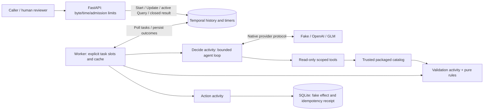

# Architecture and design check

The current design fits this backend: FastAPI translates HTTP operations;
Temporal owns durable orchestration, retries and the approval timer; activities
perform I/O; pure policy validates model proposals; the fake Helpdesk owns atomic
effects and receipts. A model never receives an action or approval tool.

[Flowchart source](architecture.mmd) · [Standalone SVG](architecture.svg)

## Components and ownership

| Owner | Responsibility | Boundary |
| --- | --- | --- |
| HTTP | Request validation, bounded input/errors, admission, RPC mapping | Never performs a refund itself |
| Workflow | Steps, first approval, 24-hour deadline, finite retries | Deterministic; no network/file access |
| Decide activity | Provider calls and read-only tools | Customer scope comes from the ticket; bounded JSON |
| Validation activity | Trusted invoice/KB facts and pure rules | Positive finite EUR cents, paid invoice, ownership |
| Action activity | Delivery with a stable logical action key | At-least-once execution is expected |
| Fake Helpdesk | Transactional effect/receipt, conflict detection | A row is the simulated effect, not a real payment |
| State projection | Safe legacy reads and bounded completion | Preserves action/receipt identity; flags omitted legacy text |

## Research: why these boundaries are appropriate

1. **Durable wait and external I/O are separated.** Temporal requires replay-safe
   workflow logic; external calls belong in activities. The workflow can wait for
   approval without a sleeping HTTP request or a dedicated process.
   [Temporal workflow versioning](https://docs.temporal.io/develop/python/workflows/versioning).
2. **Approval uses an Update with a validator.** This records and checks the first
   response inside the workflow, avoiding an HTTP read-then-write race. Query is
   read-only and still requires a polling worker. Closed tickets instead read
   their persisted result directly, so worker downtime does not block those reads.
   [Temporal message passing](https://docs.temporal.io/develop/python/workflows/message-passing).
3. **Retries do not imply exactly-once effects.** The stable action key plus the
   fake store's atomic transaction handles retries, overlapping attempts and lost
   acknowledgements. A real Helpdesk needs native idempotency or reconciliation;
   a local receipt cannot atomically cover an unrelated payment API.
   [Temporal error handling](https://docs.temporal.io/develop/python/best-practices/error-handling).
4. **Payload size is an application invariant.** Byte budgets apply before an
   action, and old oversized state has a bounded read/completion projection.
   External audit storage is appropriate if future requirements genuinely need
   large payloads; it is not needed for these small support decisions.
   [Temporal worker/payload guidance](https://docs.temporal.io/best-practices/worker).
5. **Overload is bounded and explicit.** Business requests receive an immediate
   503 with Retry-After when admission slots are full. Health diagnostics remain
   available. Workflow slots/cache are configured separately from activity slots.
   [Uvicorn resource limits](https://uvicorn.dev/settings/#resource-limits),
   [Temporal worker sizing](https://docs.temporal.io/best-practices/worker).
6. **HTTP errors are safe projections too.** Validation returns bounded locations,
   types and messages without serializing rejected input or exception context.
   [FastAPI error handlers](https://fastapi.tiangolo.com/tutorial/handling-errors/).
7. **Transactions and resource lifetime are explicit.** SQLite commit/rollback and
   connection closure have separate context managers.
   [Python SQLite connection lifecycle](https://docs.python.org/3.12/library/sqlite3.html#how-to-use-the-connection-context-manager).

## History compatibility

`readable-activity-errors-v1` preserves old error labels during replay while new
failures use readable timeout names. `bounded-ticket-state-v1` preserves the old
completion path on recorded histories and uses bounded output for new completion
commands. Do not remove these patches while matching histories remain retained.

Five frozen pre-fix histories replay successfully. Additional migration tests
replace an old worker after a committed oversized effect and verify the original
receipt is returned without another effect. Another test reads malformed Unicode
history safely even before its worker is upgraded. The embedded test server does
not advertise the production blob cap; its recovery test emulates that completion
failure. The real dev server is checked separately.

The public `payload_warning` field explains when historical proposal/text/details
are omitted from a view. It does not change the stored decision or receipt.

## Scope of this design

The diagram describes the working local backend. Temporal's dev server and the
single-host SQLite fake are appropriate for the demonstration, not a production
cluster. Production still needs authenticated identities, cumulative refunds
across different ticket IDs, a real Helpdesk reconciliation contract, shared
persistence, deployment versioning and operational monitoring. The existing Azure
proposal in README describes that separate deployment work.
